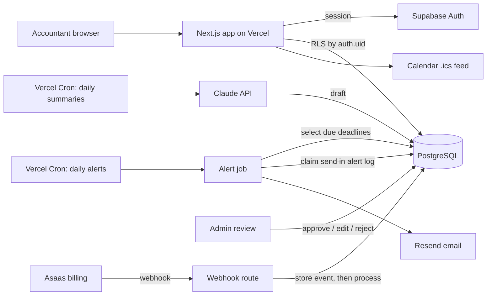

# PrazoCerto: case study

**Tax-deadline alerts for Brazilian accountants.**
Live at **[prazocerto.app](https://prazocerto.app)** (pre-launch beta) · Source code is private; this repository documents the architecture and my role.

## Problem

Accountants in Brazil track tax deadlines for dozens of small-business clients under the Simples Nacional regime, often in spreadsheets. A missed deadline means fines for the client and lost trust for the accountant. PrazoCerto gives the accountant a multi-client dashboard and emails them automatically before each deadline.

## My role

**Founder & sole engineer** (09/2026 – present). I took it from idea to production in **3 weeks**, covering product, data model, backend, frontend, billing, email and deployment. I build with Claude Code as a pair programmer, and automation comes first: anything recurring runs as a cron job or a webhook, not as a manual task.

## Stack

| Layer | Technology |
|---|---|
| App | Next.js 16 (App Router), React, TypeScript, Tailwind CSS, shadcn/ui |
| Data | Supabase: PostgreSQL, Auth, Row Level Security |
| Jobs | Vercel Cron |
| Integrations | Resend (email), Asaas (subscriptions; sandbox until launch), iCalendar feed, PDF generation |
| AI | Claude API to draft summaries of regulatory changes, reviewed by a human before publishing |
| Quality | Vitest, strict TypeScript |

## Architecture



## Technical decisions and trade-offs

- **The database enforces idempotency.** Every alert is recorded in an alert log with a unique constraint per client, deadline, lead time and channel. A cron retry or an overlapping run can never send the same alert twice, even if the application logic has a bug.
- **Webhooks: store first, process second.** Each billing event is saved by its provider ID before anything else happens, and the endpoint answers quickly. A redelivered event is detected and acknowledged without side effects. See the snippet below.
- **RLS on every table.** Each accountant can only reach their own rows; tables are created together with their policies.
- **Serverless cron instead of a queue.** Two daily Vercel Cron jobs cover the workload with no worker infrastructure to run. The trade-off is coarse scheduling and per-invocation time limits, which is fine at this volume. A worker queue is the upgrade path if volume grows.
- **Correctness over guessing.** Deadline data comes from a curated catalog checked against official sources and is never inferred. When a date is uncertain, the product flags it instead of filling it in.
- **AI with a human in the loop.** The model drafts summaries of regulatory changes, a validation step checks each draft, and an admin approves, edits or rejects it before anything reaches users.

## Results

- **Idea to production in 3 weeks.**
- **127 tests** (Vitest).
- Pre-launch beta: end-to-end alert delivery validated with real email, billing integrated against the Asaas sandbox.

## Code sample: idempotent billing webhook

Sanitized excerpt: identifiers and comments are translated from Portuguese and status handling is simplified.

```ts
import { timingSafeEqual } from 'node:crypto'
import { NextResponse, type NextRequest } from 'next/server'

// Constant-time token comparison prevents timing attacks on the shared secret.
function isAuthorized(request: NextRequest): boolean {
  const token = process.env.BILLING_WEBHOOK_TOKEN
  if (!token) return false
  const received = Buffer.from(request.headers.get('asaas-access-token') ?? '')
  const expected = Buffer.from(token)
  return received.length === expected.length && timingSafeEqual(received, expected)
}

export async function POST(request: NextRequest) {
  if (!isAuthorized(request)) return NextResponse.json({ error: 'unauthorized' }, { status: 401 })

  const event: unknown = await request.json().catch(() => null)
  if (!isBillingEvent(event)) return NextResponse.json({ error: 'invalid event' }, { status: 400 })

  const db = createAdminClient()

  // 1) Store the event first. Only fail the request when even this fails,
  //    because the provider pauses delivery after repeated errors.
  const { data: inserted, error } = await db
    .from('billing_event')
    .upsert({ id: event.id, type: event.event, payload: event }, { onConflict: 'id', ignoreDuplicates: true })
    .select('id')
  if (error) return NextResponse.json({ error: 'could not store event' }, { status: 500 })

  // 2) A redelivery of an event that was already processed: acknowledge, do nothing.
  if (inserted.length === 0) {
    const { data: existing } = await db.from('billing_event').select('processed_at').eq('id', event.id).single()
    if (existing?.processed_at) return NextResponse.json({ ok: true, duplicate: true })
  }

  // 3) Apply the subscription status change, then mark the event as processed.
  const failure = await applySubscriptionStatus(db, event)
  await db
    .from('billing_event')
    .update({ processed_at: new Date().toISOString(), error: failure })
    .eq('id', event.id)

  return NextResponse.json({ ok: true })
}
```
